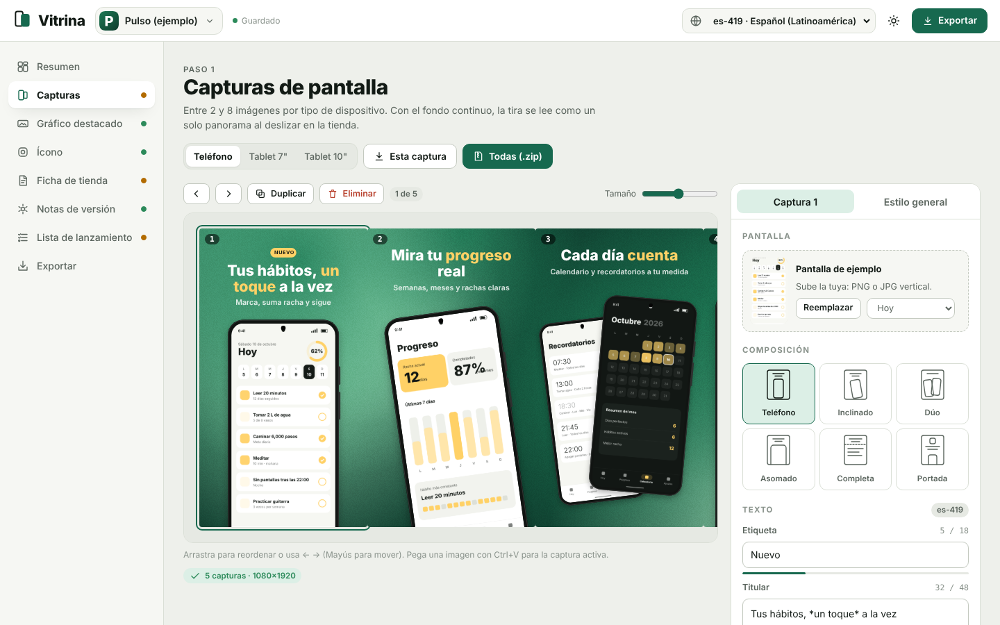
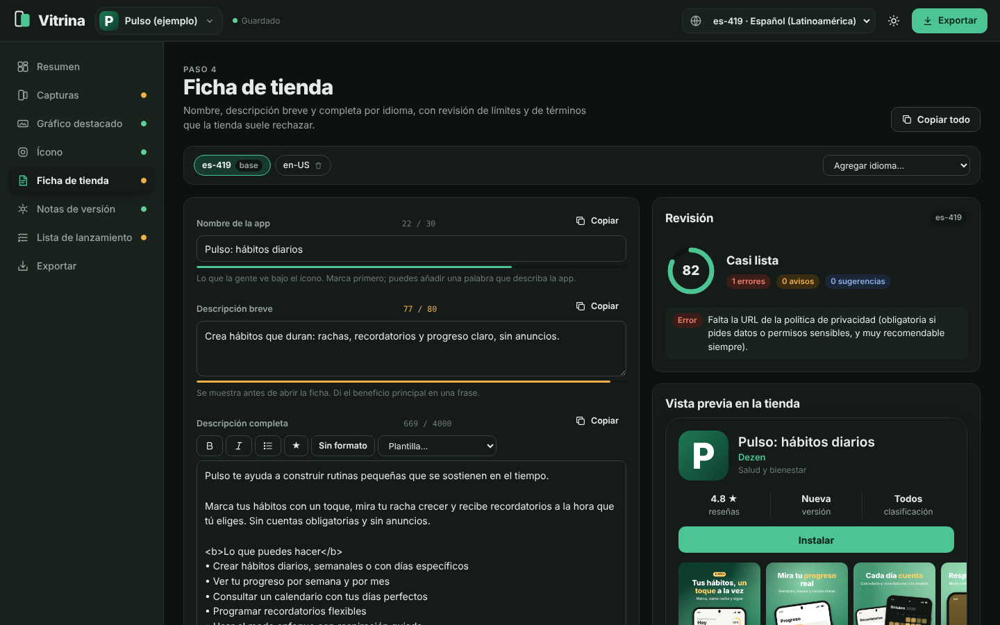

# Vitrina

**Kit de lanzamiento para Google Play que corre en tu navegador.** Diseña las capturas con marco de dispositivo, el gráfico destacado y el ícono; escribe y revisa la ficha en varios idiomas; genera las notas de versión y descarga todo en un ZIP con la estructura de metadatos de [fastlane](https://docs.fastlane.tools/actions/supply/). Nada sale de tu equipo: los proyectos se guardan en IndexedDB.



## Qué incluye

### Capturas de pantalla
- Hasta 8 capturas por dispositivo: **teléfono (1080×1920)**, **tablet de 7" (1440×2560)** y **tablet de 10" (2160×3840)**.
- 6 composiciones: teléfono, inclinado, dúo, asomado, pantalla completa y portada con ícono.
- **Fondo continuo**: la tira completa se pinta como un panorama que fluye de una captura a otra.
- 10 temas listos y edición fina: fondo sólido, degradado, radial, malla u ola; patrones; grano.
- 10 tipografías, alineación, posición del texto, tamaños, etiqueta tipo insignia y **resaltado con `*asteriscos*`** (en color o con marcador).
- Marcos genéricos (moderno, sin marco, contorno y arcilla) con color, escala, inclinación y sombra.
- **Tema desde el ícono**: extrae los colores dominantes y arma una combinación legible.
- Indicador de contraste del texto, ideas de titulares, fondo propio por captura.
- Arrastrar para reordenar, soltar o pegar (Ctrl+V) una imagen, atajos `←` `→`, `Mayús+←/→` y `D`.
- Pantallas de ejemplo dibujadas por código para diseñar antes de tener capturas reales.

### Gráfico destacado (1024×500)
- Composiciones dividida, centrada, escaparate (tres teléfonos) y minimal con marcador.
- Frase por idioma, guía de zona segura y el mismo estilo que las capturas.

### Ícono
- Primer plano con letras, 22 símbolos o tu logotipo; fondo sólido, degradado, radial, malla o vacío.
- Sombra, sombra larga, rotación y escala; vista con 5 máscaras y la guía de zona segura adaptable.
- Vista previa en una pantalla de inicio y en 5 tamaños.
- **Kit para Android Studio**: `mipmap-*` en 5 densidades, ícono redondo, capas del ícono adaptable (con `monochrome`) y la versión de 512 px.

### Ficha de tienda
- Nombre (30), descripción breve (80) y completa (4000) por idioma, con contadores.
- **Revisión automática**: límites, emojis, términos de ranking o promoción en cada idioma, etiquetas HTML no admitidas, menciones de otras tiendas, peticiones de calificación, relleno de palabras clave, correo y política de privacidad.
- Puntuación por idioma, análisis de palabras más usadas y seguimiento de tus palabras clave.
- Barra de formato (`<b>`, `<i>`, viñetas), 3 plantillas de descripción en español e inglés.
- **Vista previa** de cómo se verá la ficha con ícono, capturas y descripción.
- 21 idiomas disponibles; copiar los textos del idioma base para traducir.

### Notas de versión
- Escribe cada cambio una vez por idioma (nuevo, mejora o corrección) y obtén el texto final con tono cercano, formal o breve, con o sin emojis, en español, inglés, portugués, francés o alemán.
- Contador de 500 caracteres, edición manual que se conserva y **copia para Play Console** con etiquetas `<es-419>…</es-419>`.
- Historial de versiones con nombre y `versionCode`.

### Lista de lanzamiento
30 puntos en 5 grupos (recursos, ficha, Play Console, compilación, pruebas). Los que dependen del proyecto se marcan solos; el resto se guarda contigo.

### Exportar
Un ZIP con esta estructura:

```
mi-app-launch-kit/
├── fastlane/metadata/android/<idioma>/
│   ├── title.txt · short_description.txt · full_description.txt
│   ├── changelogs/<versionCode>.txt
│   └── images/icon.png · featureGraphic.png · phoneScreenshots/ · sevenInchScreenshots/ · tenInchScreenshots/
├── android-icons/res/mipmap-*/ …
├── mi-app.vitrina.json
└── LEEME.txt
```

Súbelo con `fastlane supply --skip_upload_aab` o arrastra cada archivo a Play Console.



## Proyectos
- Varios proyectos con guardado automático en el navegador.
- Duplicar, renombrar, eliminar, guardar como `.vitrina.json` y abrirlo en otra computadora.
- Modo claro y oscuro; interfaz adaptada a móvil.

## Uso

```bash
git clone https://github.com/dezenbit/vitrina.git
cd vitrina
python3 -m http.server 8080   # o abre index.html directamente
```

No hay dependencias que instalar. JSZip y las tipografías se cargan desde CDN.

## Estructura

```
vitrina/
├── index.html
├── css/vitrina.css
└── js/
    ├── util.js            DOM, color, IndexedDB, imágenes, descargas, fuentes
    ├── samples.js         proyecto y pantallas de ejemplo
    ├── draw.js            fondos, marcos, texto resaltado, capturas, gráfico e ícono
    ├── text.js            idiomas, límites, revisión, palabras clave, notas de versión
    ├── ui.js              controles reutilizables
    ├── views-visual.js    Capturas · Gráfico destacado · Ícono
    ├── views-text.js      Ficha · Notas de versión
    ├── views-launch.js    Resumen · Lista de lanzamiento · Exportar
    └── app.js             proyectos, guardado y navegación
```

### Agregar un tema
Añade una entrada a `THEMES` en `js/draw.js`:

```js
cacao: { label: 'Cacao', bgType: 'mesh', c1: '#2b1a12', c2: '#7a4a2a', c3: '#e0b07a', text: '#fff7ee', accent: '#ffcf70', badgeBg: '#ffcf70', frameColor: '#120a06' },
```

## Aviso

Los límites y requisitos de Google Play cambian con el tiempo (por ejemplo, el nivel mínimo de `targetSdk` o las pruebas cerradas para cuentas nuevas). Vitrina los usa como guía; confirma siempre en Play Console antes de publicar. Los marcos de dispositivo son genéricos y no reproducen ningún modelo comercial.

## Licencia

[MIT](LICENSE) © 2026 Dezen

## Autor

Hecho por **Dezen** · [GitHub](https://github.com/dezenbit) · [X](https://x.com/Dezenbitw) · [Instagram](https://www.instagram.com/dezenbit2) · dezen.dev@gmail.com

☕ ¿Te gusta este proyecto? [Invítame un café en Ko-fi](https://ko-fi.com/dezenbitw)
